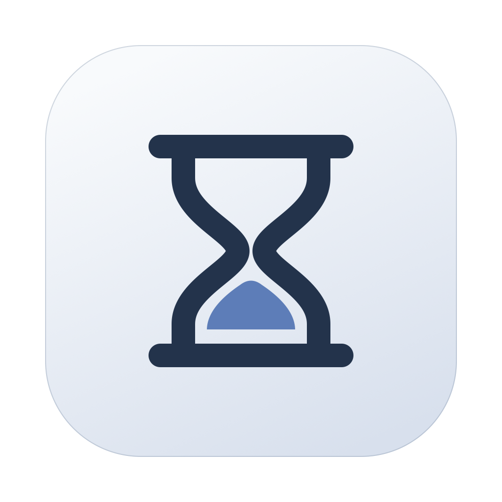
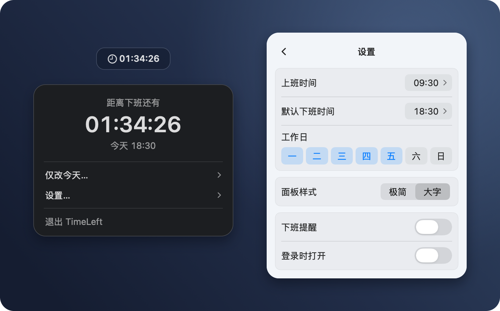

<p align="center">
  
</p>
<h1 align="center">TimeLeft</h1>
<p align="center"><strong>macOS 菜单栏里的下班倒计时</strong></p>
<p align="center">自定义上下班时间和工作日，在菜单栏查看还剩多久。<br>macOS 13 或更新版本 · Swift · 本地运行</p>



## 功能

- **下班倒计时**　菜单栏按秒显示剩余时间，面板支持极简、大字和系统浅深色。
- **作息设置**　默认周一至周五 18:30 下班。可设置工作日和上下班时间，也可临时修改今天的下班时间。
- **休息日与下班后**　设置上班时间后，面板会显示下次上班时间。当天已下班时也能查看下班多久了。
- **系统提醒与登录项**　下班通知和登录时自动启动可单独开启。设置保存在本机。

## 构建与安装

需要 macOS 13 或更新版本和 Xcode Command Line Tools。首次配置开发工具可运行 `xcode-select --install`。

```sh
git clone https://github.com/ygttygtt/TimeLeft.git
cd TimeLeft
./scripts/build.sh
```

构建脚本会生成带本地签名的 `dist/TimeLeft.app`。在 Finder 中将它拖到「应用程序」，双击后从菜单栏的时钟图标打开。更新时先退出 TimeLeft，再替换原位置的应用。

## 实现

AppKit 状态项和原生弹层，SwiftUI 设置界面。以系统时间计算倒计时，跨日、唤醒或时区变化后会重新计算。使用系统通知与登录项，无第三方运行依赖。

[开发记录](docs/development.md)
